  

# 📦 Awesome Shipping & Logistics Platform 🚚

A curated catalog of premier **multi-carrier shipping software**, **logistics operations platforms**, **shipping APIs**, **automated label generation tools**, and **open-source logistics engines**. Whether you run a high-volume direct-to-consumer (DTC) ecommerce brand, an omnichannel marketplace, a 3PL warehouse, or a freight forwarding network, this guide details enterprise and developer solutions with verified pricing, free tier limits, company valuations, and repository star metrics.

---

## 📑 Table of Contents
- [📈 Sector Overview & Market Dynamics](#-sector-overview--market-dynamics)
- [☁️ SaaS & Hosted Platforms](#-saashosted-platforms)
- [💻 Open-Source GitHub Projects](#-open-source-github-projects)
- [🛠️ Architectural Building Blocks](#️-architectural-building-blocks)
- [💖 Support](#-support)
- [⭐ Star History](#-star-history)
- [🤝 How to Contribute](#-how-to-contribute)
- [⚠️ Disclaimer & License Terms](#️-disclaimer--license-terms)

---

## 📈 Sector Overview & Market Dynamics

The global **logistics software market** is estimated at **$11B–$16B** (with the dedicated multi-carrier parcel management software segment accounting for **$0.8B–$3.8B**), expanding at an annual growth rate (CAGR) of **8%–11%** fueled by global omnichannel retail and supply-chain modernization.

The sector is **moderately to highly fragmented rather than winner-take-all**—while consolidated giants (like Shopify and Auctane/Thoma Bravo) capture widespread SMB and merchant market share, no single provider controls carrier connectivity globally, leaving substantial room for regional parcel consolidators, specialized freight marketplaces, and self-hosted open-source logistics frameworks.

---

## ☁️ SaaS/Hosted Platforms

The table below lists the top commercial shipping, rate shopping, label generation, and logistics platforms, **sorted in descending order by company size (valuation / annual revenue)**.

| Platform | Company Size (Valuation / Revenue) | Starting Tier Price | Free Tier / Free Trial Limits | Core Focus & Features |
| :--- | :--- | :--- | :--- | :--- |
| **[Shopify Shipping](https://www.shopify.com/shipping)** | **~$137B–$200B+ Mkt Cap** ($11.5B+ Rev) | **$39/month** (Shopify Basic tier, includes native shipping) | **3-day free trial** + $1/mo promo for first 3 months; no permanent free tier | Native merchant shipping suite offering pre-negotiated carrier discounts (up to 88% off USPS/UPS/DHL), automated return label creation, and seamless store fulfillment. |
| **[ShipStation](https://www.shipstation.com/)** | **~$6.6B Auctane Acquisition** (~$800M+ Parent Rev) | **$14.99/month** (Starter tier for up to 50 shipments/mo) | **30-day free trial** (Unlimited features during trial; postage purchased separately) | Multi-carrier shipping and order automation for omnichannel ecommerce; connects to 100+ selling channels, barcode scan-to-print, and rate calculators. |
| **[Stamps.com](https://www.stamps.com/)** | **~$6.6B Auctane Acquisition** (~$800M+ Parent Rev) | **$14.99/month** (Basic tier for up to 10 labels & 25 stamps/mo) | **30-day free trial** ($100 postage value offer upon signup; trial rolls over to paid tier) | Official USPS-licensed postage printing and shipping software for offices and low-to-mid volume ecommerce shippers needing certified mail and package labels. |
| **[Pitney Bowes](https://www.pitneybowes.com/)** | **~$2.4B Mkt Cap** ($1.87B Rev) | **$14.99/month** (PitneyShip standard online plan) | **30-day free trial** (Full software access to compare USPS & UPS rates; postage not included) | Enterprise multi-carrier mailing and parcel logistics, shipping hardware, and parcel sorting infrastructure for high-throughput corporate mailrooms and warehouses. |
| **[EasyPost](https://www.easypost.com/)** | **$1.52B Valuation** ($100M+ Rev) | **$0/month** (Wallet carriers) / **$20/month** (Bring Your Own Carrier accounts) | **Free forever plan: Up to 3,000 labels/month** using EasyPost carrier accounts ($0.08/label overage) | Developer-centric RESTful Shipping API offering multi-carrier rating, package tracking webhooks, automated customs documentation, and address verification. |
| **[Shippo](https://goshippo.com/)** | **$1.0B Valuation** ($51M+ Rev) | **$19/month** (Professional tier unlocking automations & 5 user seats) | **Free forever plan: Up to 30 labels/month** with Shippo default carrier rates ($0.05/label for custom accounts) | End-to-end shipping dashboard and developer API featuring instant rate comparisons, branded customer tracking pages, batch label generation, and automated returns. |
| **[Sendcloud](https://www.sendcloud.com/)** | **~$750M Valuation** ($100M+ Rev) | **€28/month (~$30/mo)** (Lite tier up to 400 shipments/mo) | **Free forever plan: Up to 20 labels/month** using pre-negotiated rates (also includes 14-day free trial on paid tiers) | Leading European shipping acceleration platform connecting 100+ European & global carriers with automated label workflows, branded tracking, and localized return portals. |
| **[Parcel2Go](https://www.parcel2go.com/)** | **£100M+ (~$130M+) Annual Rev** (Mayfair PE backed) | **£9.99/month** (Plus tier unlocking Smart Send priority automation) | **Free forever plan: Standard Pay-As-You-Go** marketplace (0 subscription fee; pay per courier booking) | UK's largest courier and parcel delivery comparison engine; integrates eBay, Amazon, Etsy, and Shopify to compare DPD, Evri, UPS, and Royal Mail options. |
| **[Pirate Ship](https://www.pirateship.com/)** | **~$50M–$63M+ Estimated Rev** (Bootstrapped & profitable) | **$0/month** (100% free software, zero subscription or markup fees) | **Free forever unlimited: 0 monthly fee, 0 markup** on all volume levels (no limit on shipments) | Cost-leader shipping software providing direct access to discounted USPS Commercial Pricing, USPS Cubic rates, and UPS Ground Saver with zero subscription fees. |
| **[Freightos](https://www.freightos.com/)** | **~$40M Mkt Cap** (NASDAQ: CRGO, ~$30M+ Rev) | **$119/month** (Freightos Terminal Ocean / Market Intelligence tier) | **Free forever plan: Free freight marketplace booking** for instant international air and ocean spot quotes | International freight rate marketplace and booking digitizer connecting importers and exporters with global air cargo and ocean container freight forwarders. |

---

## 💻 Open-Source GitHub Projects

The table below lists community-driven, self-hosted, and open-source shipping and logistics frameworks, **sorted in descending order by GitHub_Stars_Count**. Each repository badge links directly to its stargazer community.

| Project | GitHub_Stars | Primary Language / Stack | License | Key Logistics Architecture |
| :--- | :---: | :--- | :--- | :--- |
| **[GreaterWMS](https://github.com/GreaterWMS/GreaterWMS)** |  | Python / Django / Vue.js | Apache-2.0 | Fully featured open-source Warehouse Management System (WMS) born out of automotive supply-chain operations; covers inbound sorting, bin allocation, pick-and-pack, and multi-warehouse stock movements. |
| **[Fleetbase](https://github.com/fleetbase/fleetbase)** |  | PHP / Laravel / Ember.js | AGPL-3.0 | Modular Logistics Operating System (LSOS) for last-mile delivery and dispatch; provides `fleetops` for driver telematics, route assignment, live GPS tracking, and proof-of-delivery (PoD). |
| **[VROOM](https://github.com/VROOM-Project/vroom)** |  | C++ / NodeJS / Docker | BSD-2-Clause | Ultra-fast Vehicle Routing Open-source Optimization Machine; solves complex Traveling Salesperson (TSP) and Capacitated Vehicle Routing Problems (CVRP) with time windows and pickup-and-delivery constraints. |
| **[OpenBoxes](https://github.com/openboxes/openboxes)** |  | Groovy / Grails / Java | Eclipse Public | Enterprise supply-chain and inventory tracking system built for complex distribution environments; manages cold-chain validation, purchase order tracking, shipment manifests, and cross-docking. |
| **[Karrio](https://github.com/karrioapi/karrio)** |  | Python / Django / React | Apache-2.0 | Programmable multi-carrier shipping engine and self-hosted API alternative to EasyPost and Shippo; unifies live rate calculation, PDF/ZPL label generation, document customs forms, and tracking webhooks across carriers. |
| **[org.openwms](https://github.com/openwms/org.openwms)** |  | Java / Spring Boot / Microservices | Apache-2.0 | Modern distributed warehouse control and inventory management framework; modular architecture built for material flow control, automated conveyor systems, picking stations, and shipping dispatch. |
| **[PyVRP](https://github.com/PyVRP/PyVRP)** |  | Python / C++ | MIT | State-of-the-art vehicle routing problem solver library; optimizes complex logistics dispatching, fleet capacity limits, duration limits, and multi-stop delivery routes with high computational efficiency. |
| **[CoopCycle](https://github.com/coopcycle/coopcycle-web)** |  | PHP / Symfony / React Native | AGPL-3.0 | Complete open-source delivery dispatch and marketplace platform created for worker-owned bike courier cooperatives; offers order management, route dispatching, mobile driver app, and customer tracking. |
| **[stock-logistics-warehouse (OCA)](https://github.com/OCA/stock-logistics-warehouse)** |  | Python / Odoo | AGPL-3.0 | Suite of Odoo Community Association (OCA) modules expanding inventory and warehouse operations with advanced wave picking, storage packaging rules, and cross-docking controls. |
| **[delivery-carrier (OCA)](https://github.com/OCA/delivery-carrier)** |  | Python / Odoo | AGPL-3.0 | Standard Odoo carrier integrations and label-generation modules; provides uniform carrier file output, automated tracking number updates, and shipping cost calculations for enterprise ERP users. |
| **[Shippy](https://github.com/verbb/shippy)** |  | PHP | MIT | Lightweight, framework-agnostic multi-carrier shipping package for PHP developers; supports seamless calculation of shipping rates, validation, and label endpoints across common couriers. |

---

## 🛠️ Architectural Building Blocks

When architecting a production-grade, self-hosted shipping and logistics infrastructure:
1. **Carrier API & Label Generation Layer**: Use **[Karrio](https://github.com/karrioapi/karrio)** for rate shopping across USPS, FedEx, DHL, and UPS, generating shipping labels, and normalizing tracking statuses into webhooks.
2. **Dispatch & Route Optimization Engine**: Pair **[VROOM](https://github.com/VROOM-Project/vroom)** or **[PyVRP](https://github.com/PyVRP/PyVRP)** with OpenStreetMap/OSRM to compute optimal driver routing and reduce fuel and dispatch overhead.
3. **Warehouse Operations & Inventory Layer**: Deploy **[GreaterWMS](https://github.com/GreaterWMS/GreaterWMS)** or **[OpenBoxes](https://github.com/openboxes/openboxes)** to handle warehouse barcoding, SKU location tracking, wave picking, and container packing.
4. **Fleet & Last-Mile Management**: Deploy **[Fleetbase](https://github.com/fleetbase/fleetbase)** or **[CoopCycle](https://github.com/coopcycle/coopcycle-web)** to handle mobile driver navigation, real-time geofenced ETA alerts, and photographic proof-of-delivery (PoD).

---

## 💖 Support

Thank you for exploring and utilizing this curated directory! If this ecosystem guide helped you navigate shipping APIs, open-source logistics frameworks, or warehouse tech stacks, please consider showing your support:

- ⭐ **Star this repository** on GitHub to help others discover it.
- 🍴 **Fork and share** the project with your team and community.
- 📢 **Share this list** with fellow ecommerce merchants, 3PL managers, and logistics developers.
- ☕ **Buy me a coffee / Sponsor**: If you find continuous value in this work, consider supporting through the [GitHub Sponsor Dashboard](https://github.com/sponsors/ishandutta2007).

---

##  Star History

---

## 🤝 How to Contribute

Contributions are welcome! Help keep this shipping and logistics guide accurate and up-to-date:

1. **Fork** this repository.
2. Create your feature branch (`git checkout -b feature/add-carrier-platform`).
3. Add or update entries with verified corporate revenue/valuation, starting tier prices, free tier limits, and GitHub stargazer badges.
4. Keep commentary strictly objective and factual.
5. Commit your changes and open a **Pull Request** detailing your update.

---

## ⚠️ Disclaimer & License Terms

- This directory is community-curated for informative, architectural, and educational purposes. Inclusion does not imply formal commercial endorsement.
- Verify carrier compliance, data protection standards (GDPR, SOC2, PCI-DSS), and secure token handling before handling commercial customer address books and shipping payment APIs in production.
- Review open-source licenses carefully before commercial bundling (`Apache-2.0`, `MIT`, `Eclipse Public`, `AGPL-3.0`).

---

  Built with ❤️ for ecommerce merchants, 3PL managers, fleet operators, and logistics platform engineers.

